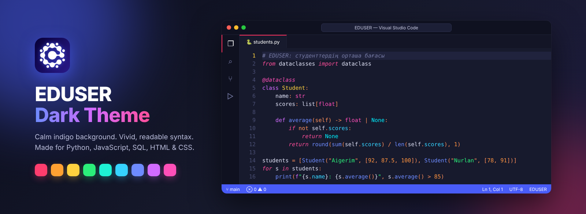
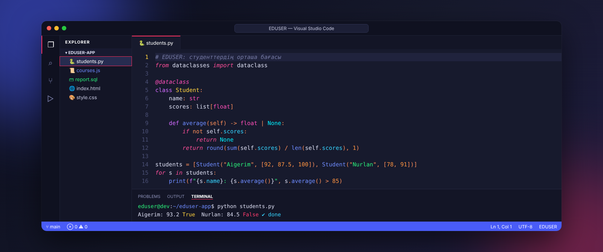
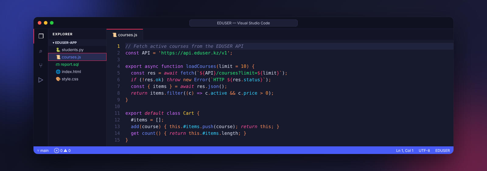
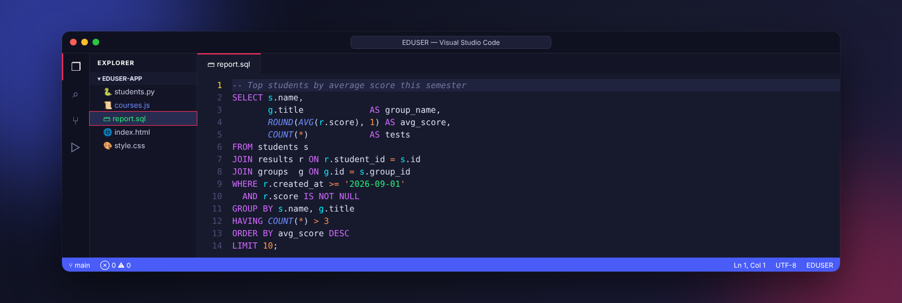
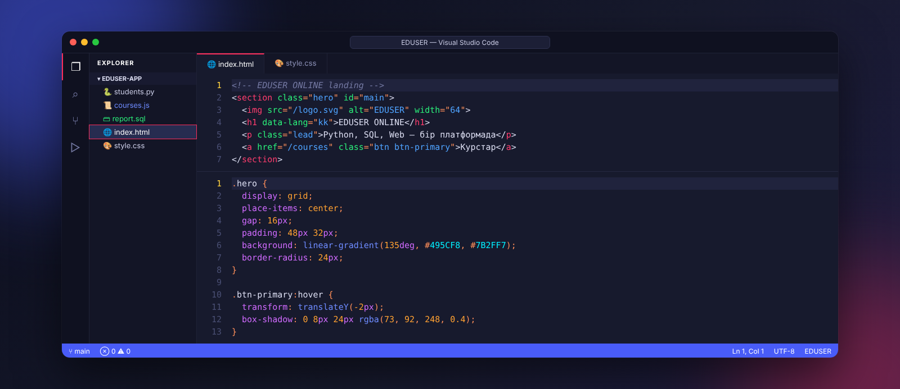
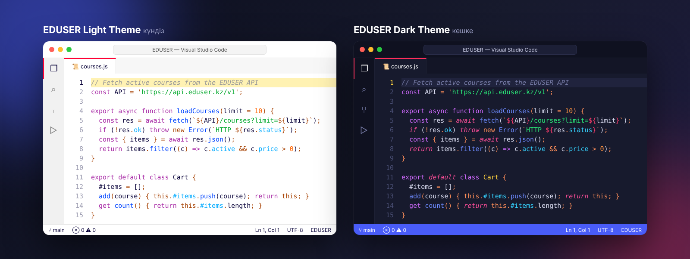

<p align="center">
  
</p>

# EDUSER Dark Theme

**Calm indigo background. Vivid, readable syntax.** The night-time companion of **EDUSER Light Theme**, made by the EDUSER ONLINE learning centre for students who code in Python, JavaScript, SQL, HTML and CSS.

The background is a low-saturation indigo-blue (`#171A2D`) that stays easy on the eyes through long lessons, while syntax colors keep the same roles as the light theme, so switching between day and night feels natural.

## Two themes, one place

This repository holds both EDUSER themes for VS Code:

| Theme | Install | Source |
|---|---|---|
| **EDUSER Dark Theme** | [Marketplace](https://marketplace.visualstudio.com/items?itemName=eduser.eduser-dark-theme) | repository root |
| **EDUSER Light Theme** | [Marketplace](https://marketplace.visualstudio.com/items?itemName=eduser.eduser-light-theme) | [`light/`](https://github.com/aidoszhumanazar/eduser-dark-theme/tree/main/light) |

## Python



## JavaScript



## SQL



## HTML & CSS



## Light by day, dark by night



Install both themes and let VS Code follow your OS automatically:

```json
{
  "window.autoDetectColorScheme": true,
  "workbench.preferredLightColorTheme": "EDUSER Light Theme",
  "workbench.preferredDarkColorTheme": "EDUSER Dark Theme"
}
```

## Palette

| Role | Color | |
|---|---|---|
| Background | `#171A2D` | calm indigo-blue |
| Text | `#DCDEF2` | soft white, no glare |
| Keywords | `#D16BFF` | electric violet |
| Control flow (`if`, `return`, `await`) | `#FF4F9A` | italic pink |
| Functions | `#6E8BFF` | EDUSER periwinkle |
| Classes & types | `#FFD23F` | gold |
| Strings | `#2BEE7A` | emerald |
| Numbers | `#FF9340` | tangerine |
| Properties | `#36D3FF` | cyan |
| HTML tags | `#FF3D6E` | raspberry |
| Accent | `#FF2E5B` / `#495CF8` | EDUSER red and blue |

## Features

- Low-saturation indigo-blue workbench that is easy on the eyes
- EDUSER blue status bar and red accents (cursor, active tab, focus)
- Vivid syntax colors with strong contrast (WCAG AA for code text)
- Same syntax groups as the light theme: SQL, HTML, CSS, JavaScript and Python
- Extra coverage for TypeScript, JSON and Markdown
- Fully styled UI: Activity Bar, Sidebar, Tabs, Panel, menus, widgets, notifications, terminal

## Installation

1. Open **Extensions** in VS Code (`Ctrl+Shift+X`).
2. Search for **EDUSER Dark Theme** and click **Install**.
3. Choose **EDUSER Dark Theme** in the Color Theme picker (`Ctrl+K Ctrl+T`).

## Old EDUSER colors in settings.json

If you once pasted the EDUSER light colors into your `settings.json`, they used to cover every theme. EDUSER Dark Theme fixes this automatically: when you select it, those colors are moved under `"[EDUSER Light Theme]"`, so the light theme looks exactly the same and the dark theme shows fully. Nothing else in your settings is changed.

## Recommended settings

```json
{
  "editor.fontFamily": "'Consolas', 'Roboto Mono', 'Ubuntu Mono', monospace",
  "editor.fontSize": 16,
  "editor.lineHeight": 1.4,
  "editor.semanticHighlighting.enabled": true
}
```

## License

MIT © EDUSER
